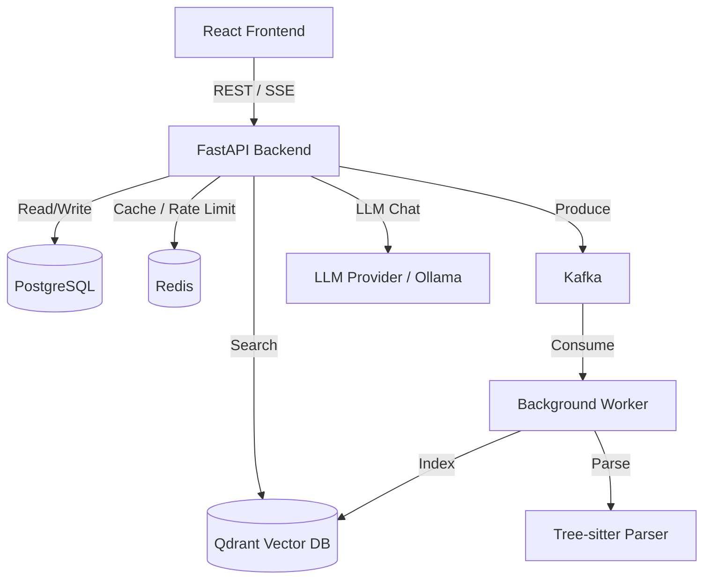

# System Design

## Overview
CodeLens is an AI-powered Codebase Intelligence platform.

## RAG Pipeline
1. **Retrieve**: Semantic Search (Qdrant) + Keyword Search (PostgreSQL)
2. **Fuse**: Reciprocal Rank Fusion (RRF)
3. **Rerank**: Cross-Encoder Reranker
4. **Generate**: LLM with strict context grounding and citation generation
